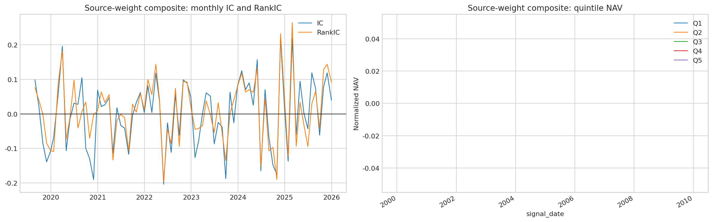
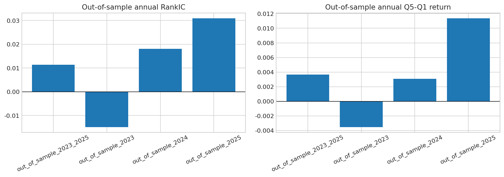
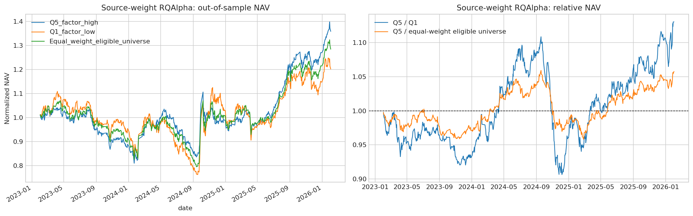
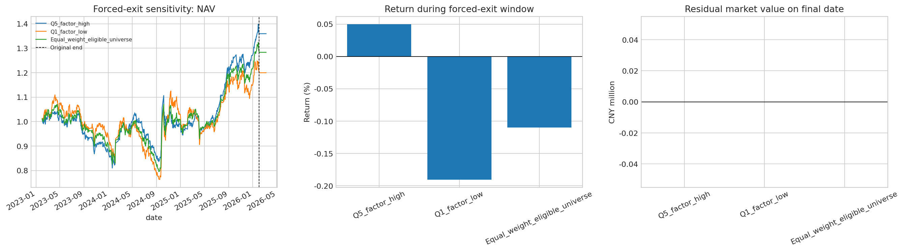

# A 股综合盈利因子复现与执行约束回测

> 当前研究状态：`candidate_not_confirmed`

本项目复现并检验招商证券盈利能力评价框架中的**综合盈利因子**。项目重点不是展示历史收益，而是检验该信号在严格样本外、可执行交易约束和交易成本假设下，能否形成稳定的横截面排序能力与独立的增量选股收益。

## 当前主结果

当前主结果是“研报原始权重版本”的扩展复现。它沿用项目既有的四个底层子因子重构口径、数据时点、股票池、样本划分、标签和 RQAlpha 执行规则，只将最终合成权重改为研报第 7.2 节的两层融合规则：前三项等权汇总后，与 FCFFIC 各占 50%。展开后的权重为 `1/6、1/6、1/6、1/2`。

四个底层子因子为：

1. 线性剥离杠杆后稳定的 ROE；
2. 稳定的 ROIC；
3. 稳定的 RONOA；
4. FCFFIC。

当前项目的 ROIC、RONOA 和 FCFFIC 使用既有的透明代理或重构口径。因此，这是**研报权重版本复现**，不是对研报全部 Wind 原始字段的逐字段完全复现。

## 核心结论

- 严格样本外 2023—2025 的平均 RankIC 为 **0.01136**，HAC p 值为 **0.4796**；
- 样本外 Q5-Q1 月均收益为 **0.3642%**，HAC p 值为 **0.4300**；
- RQAlpha 回测中，Q5 累计收益为 **35.902%**，高于 Q1 的 **20.226%** 和等权可投资股票池的 **28.489%**；
- 追加 20 个真实交易日的零权重清仓窗口后，Q5 相对 Q1 的逐日净值比值收益为 **13.577%**，相对等权可投资股票池为 **6.196%**；
- 三个组合均完成清仓，最终股票市值为零；
- 但 RankIC 与 Q5-Q1 的完整样本外 HAC 检验均未通过 5% 显著性门槛。因此，当前版本保留为研究候选，不认定为已确认的独立 Alpha。

完整解读见 [研报原始权重版本研究报告](docs/11_SOURCE_WEIGHT_COMPOSITE_PROFITABILITY_FACTOR_REPORT.md) 与[扩展复现协议](docs/11_SOURCE_WEIGHT_REPLICATION_PROTOCOL.md)。

## 研究设计

- 股票池：动态中证 800；上市满 252 个交易日；信号日排除 ST 与停牌股票；
- 有效因子样本：四个底层子因子与中性化字段共同可用的 2019—2025 月度样本；
- 样本内 / 严格样本外：有效样本中的 2019—2022 / 2023—2025；
- 标签：月末信号后首个交易日开盘买入、T+21 开盘卖出，即未来 20 个交易日开盘到开盘收益；
- 处理：MAD 去极值、中信 2019 一级行业与对数市值中性化、z-score 标准化；
- 执行：RQAlpha 开盘撮合、最低佣金、佣金、印花税、涨跌停、整手与 5% 成交量上限；
- 评估：IC、RankIC、五分组收益、Q5-Q1、Newey-West/HAC、Sharpe、信息比率、回撤与强制清仓。

## 权重敏感性对照

仓库保留了一个历史“等权合成对照版本”：四个底层子因子均为 25%。该版本的结果和 `v0.1-research-freeze` 标签保持不变，仅作为权重敏感性对照。它不能验证或否定研报原始权重公式。对照说明见 [等权合成对照版本报告](docs/11_COMPOSITE_PROFITABILITY_FACTOR_EQUAL_WEIGHT_IMPLEMENTATION.md)。

## 目录说明

- `notebooks/`：无输出、可阅读的研究流程；Notebook 11 用于研报原始权重版本；
- `scripts/`：跨 Python 3.9 与 Python 3.6/RQAlpha 的断点回测与聚合脚本；
- `lib/`：通用数据处理、统计检验与 RQAlpha 回测工具；
- `artifacts/tables/`：可公开的聚合结果；
- `artifacts/figures/`：研究图表；
- `artifacts/metadata/`：规则、参数与决策元数据；
- `docs/`：研究协议、主研究报告与历史对照报告。

## 关键图表

### 因子有效性与年度稳定性

### RQAlpha 三组合与强制清仓

## 公开边界

公开版本不包含原始市场数据、个股面板、缓存、目标权重、原始回测对象、成交明细或凭证。复现者应在拥有合法数据授权的环境中自行准备数据，并遵守数据服务协议。

## 免责声明

本项目仅用于量化研究与工程展示，不构成投资建议、收益承诺或任何证券交易建议。
