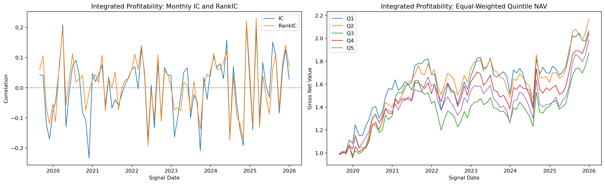
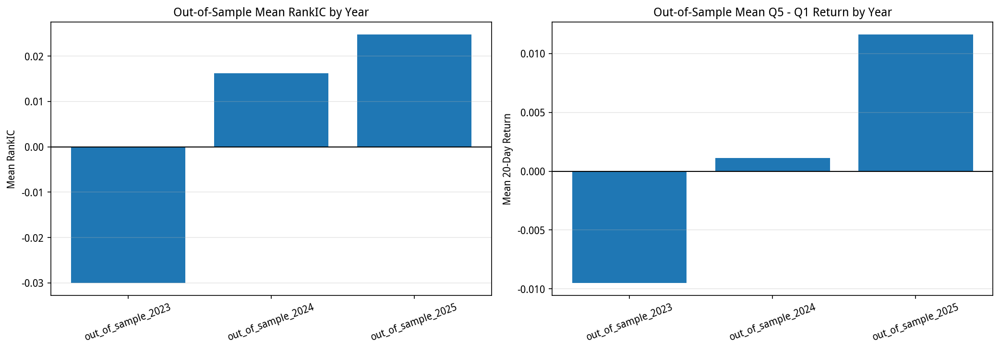
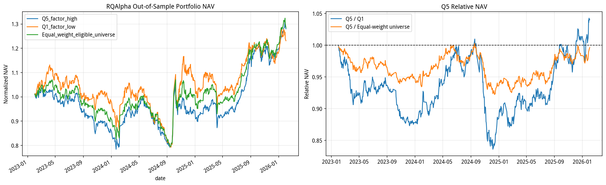
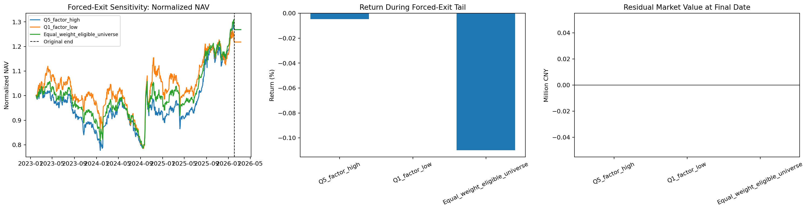

# A 股盈利能力因子透明复现研究：最终报告

## 一句话结论

本项目完成了基于研报四个底层因子的等权透明实现、样本外检验与带执行约束的 RQAlpha 回测。当前等权透明实现保留为研究候选，但未确认具有独立、稳定且超过等权可投资券池的增量选股 Alpha。

> **复现边界更正**：研报的正式最终因子名称为“综合盈利因子”。研报第 7.2 节采用两层融合，四项底层因子的隐含权重为 1/6、1/6、1/6、1/2；本项目历史结果为四项各 25% 的等权透明实现。本文所有结果与 `candidate_not_confirmed` 仅适用于后者，不验证或否定研报原始权重公式。详见 [11_COMPOSITE_PROFITABILITY_FACTOR_EQUAL_WEIGHT_IMPLEMENTATION.md](11_COMPOSITE_PROFITABILITY_FACTOR_EQUAL_WEIGHT_IMPLEMENTATION.md)。

最终状态：`candidate_not_confirmed`。

## 1. 研究问题与 Alpha 假设

研究假设是：企业的可持续盈利能力、低盈利波动、较低杠杆扭曲与较高现金盈利质量，可能反映竞争优势、资本配置质量或市场对基本面持续性的定价滞后。

本项目检验的不是“策略是否在历史上赚钱”，而是该结构化盈利信号能否：

1. 对未来 20 个交易日收益形成稳定的横截面排序；
2. 使 Q5 高分组优于 Q1 低分组；
3. 在真实成本和交易约束下，超过不按因子排序的等权可投资券池。

## 2. 数据、样本与时间对齐

- 股票池：动态中证 800；
- 研究期：2016-01 至 2025-12；
- 样本内：2016-2022；
- 样本外：2023-2025 信号，最后持有窗口延长至 2026-02；
- 标签：信号日后首个交易日开盘买入、T+21 开盘卖出；
- 处理：MAD 去极值、CITIC 2019 一级行业中性化、对数市值中性化、z-score；
- 交易：RQAlpha 开盘撮合、佣金、印花税、最低佣金、涨跌停和成交量上限；
- 评估：IC、RankIC、分组收益、Q5-Q1、HAC/Newey-West、Sharpe、信息比率、回撤与执行审计。

由于本项目是预定义因子的横截面筛选研究，而非训练机器学习模型，采用时间顺序样本内/样本外切分与 HAC 标准误，而非将样本外用于反复调参或 K-fold 优化。

## 3. 因子构造与复现边界

当前等权透明实现固定为四个底层组件各 25%：

1. 稳定去杠杆 ROE；
2. 稳定 ROIC 透明代理；
3. 稳定 RONOA 透明代理；
4. 重构 FCFFIC。

其中部分研报原始字段无法逐字段完全获得，因此项目明确使用“严格口径”或“透明代理”标识，不将代理结果表述为对原始研报的逐字逐项完全复现。

严格四组件共同可用样本使当前等权透明实现自 2019 年后才具备稳定可检验性；这是本研究的重要覆盖率边界。

## 4. 样本外因子证据

- 样本外平均 RankIC：`0.003686`；
- RankIC HAC p 值：`0.8178`；
- 样本外平均 Q5-Q1 收益：`0.1092%`；
- Q5-Q1 HAC p 值：`0.8317`；
- 强制清仓后，Q5 相对 Q1 收益：`4.1123%`；
- 强制清仓后，Q5 相对等权可投资券池收益：`-0.0359%`。

RankIC 和 Q5-Q1 虽然在样本外均为正，但 HAC 检验均不显著；Q5 能超过 Q1，却未超过等权可投资券池。因此证据不足以确认独立增量选股 Alpha。

## 5. RQAlpha 策略与执行结果

策略规则为：每月选择综合盈利因子最高 20% 的股票、等权做多；持有 20 个交易日；存在重叠持仓时按活跃 sleeves 分配资金。

| 组合                           | 原始累计收益   | 原始年化收益   |   Sharpe |   信息比率 | 最大回撤   | 强制清仓后累计收益   | 退出尾部收益   |   最终残余市值 | 完成清仓   |   尾部成交笔数 | 尾部交易成本   |
|:-------------------------------|:---------------|:---------------|---------:|-----------:|:-----------|:---------------------|:---------------|---------------:|:-----------|---------------:|:---------------|
| Equal_weight_eligible_universe | 28.49%         | 9.01%          |    0.427 |      0.689 | 25.68%     | 28.35%               | -0.11%         |              0 | True       |             10 | 6,808.66       |
| Q1_factor_low                  | 23.11%         | 7.42%          |    0.327 |      0.234 | 29.92%     | 23.11%               | 0.00%          |              0 | True       |              0 | 0.00           |
| Q5_factor_high                 | 28.01%         | 8.87%          |    0.42  |      0.582 | 24.40%     | 28.01%               | -0.00%         |              0 | True       |              3 | 10,875.00      |

Q5 的绝对收益和风险调整表现为正，但等权可投资券池的累计收益与信息比率并不更差。因此，不能把绝对收益误读为因子带来的净选股收益。

## 6. 失败案例、执行约束与强制清仓检验

RQAlpha 日志显示，部分股票在期末遇到跌停而无法立即卖出。为排除“期末市值计价”对结论的影响，三个组合均在原回测终点后追加 20 个交易日，并在每日设定零目标权重。

结果显示三个组合最终残余市值均为零，完成清仓。强制清仓后，Q5 相对等权券池仍为负值，研究结论不依赖期末未成交头寸。

## 7. 最终研究决策

| 证据                               | 发现                                     | 研究含义                                                                 |
|:-----------------------------------|:-----------------------------------------|:-------------------------------------------------------------------------|
| 严格样本外 RankIC HAC 检验         | RankIC HAC p=0.8178，未达到显著性门槛。  | 不确认稳定横截面排序 Alpha。                                             |
| 严格样本外 Q5-Q1 HAC 检验          | Q5-Q1 HAC p=0.8317，未达到显著性门槛。   | 不确认显著多空收益。                                                     |
| RQAlpha 强制清仓后 Q5 相对 Q1      | 相对收益为 4.1123%。                     | 保留高低分组的正向排序证据。                                             |
| RQAlpha 强制清仓后 Q5 相对等权券池 | 相对收益为 -0.0359%，仍未转正。          | 不确认增量选股 Alpha。                                                   |
| 期末强制退出可执行性               | 三个组合均在 20 个追加交易日内完成清仓。 | 原结论不依赖 2026-02-02 跌停导致的市值计价。                             |
| 最终研究状态                       | candidate_not_confirmed                  | 冻结因子定义、权重、样本划分与策略规则；不得依据既有样本外结果继续优化。 |

最终决策：`candidate_not_confirmed`。

这是一项有效的负向研究结论：当前等权透明实现具有部分排序信息，但尚不具备作为独立可交易 Alpha 的证据强度；该结论不应外推至研报原始两层权重公式。

## 8. 局限与后续方向

当前结论的主要局限包括：

- 综合因子严格共同覆盖率有限；
- RONOA、ROIC 与 FCFFIC 中部分内容为透明代理；
- 尚未进行冲击成本、容量和滑点压力测试；
- 因子在 2023 年出现明显失效，存在市场状态依赖；
- 不应使用已观察到的 2023-2025 样本外结果继续调权或调阈值。

若未来获得新的、未被用于本研究的时间段，可在独立留出样本中预先冻结规则后，检验该候选信号是否在不同市场环境下恢复稳定性。
