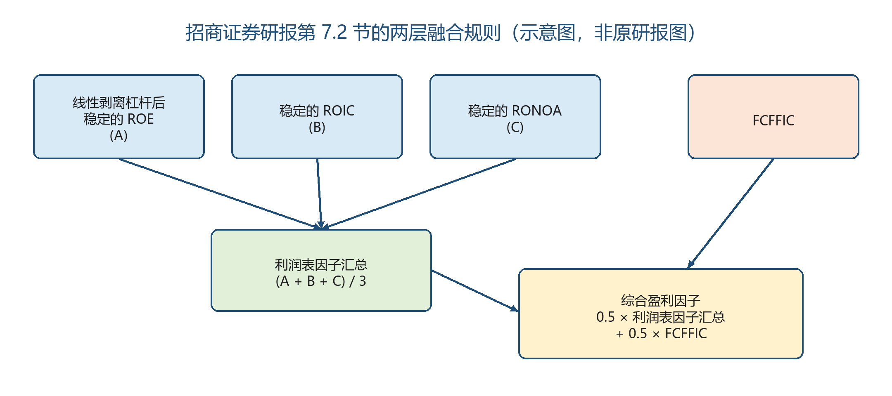
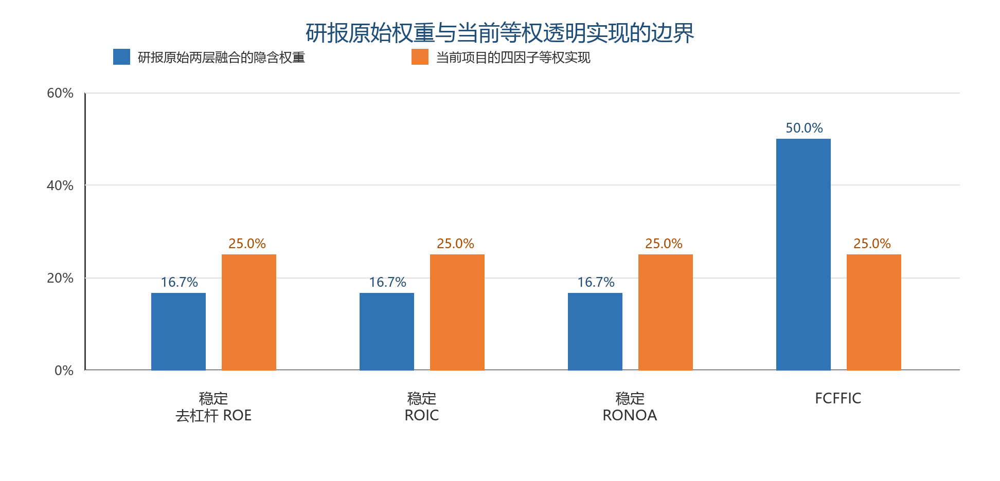
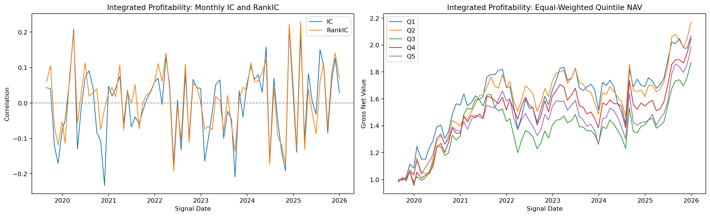
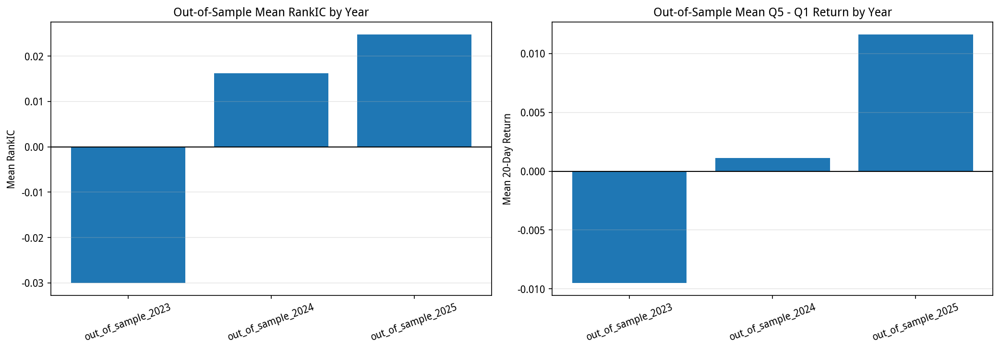
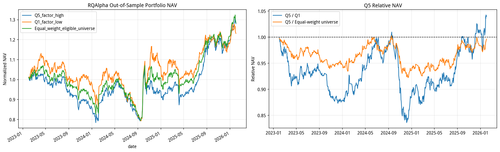
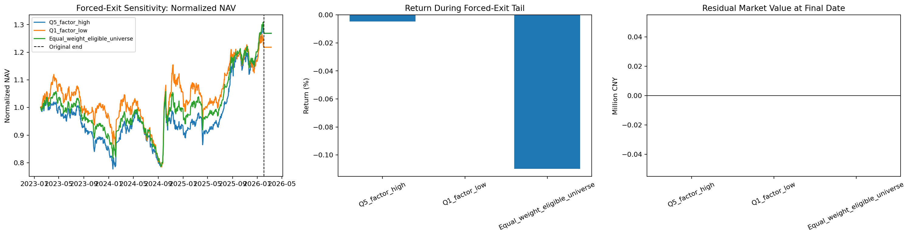

# 综合盈利因子等权合成对照版本研究报告

> 研究状态：`candidate_not_confirmed`

> **后续权重版本结果**：研报原始两层权重版本已经完成扩展复现，主结论与完整结果见 [综合盈利因子研报原始权重版本研究报告](11_SOURCE_WEIGHT_COMPOSITE_PROFITABILITY_FACTOR_REPORT.md)。本文保留历史等权合成对照版本的事实与结论，不修改 `v0.1-research-freeze` 所对应的历史结果。

本报告用于说明本项目实际完成的历史对照研究：基于招商证券盈利能力评价框架中四个底层子因子的**等权合成对照版本**、严格样本外检验与执行约束回测。

重要边界：研报的正式最终因子名称是**综合盈利因子**。本项目历史结果采用四个底层子因子各 25% 的合成方式，并非研报第 7.2 节的原始两层融合权重。因此，本文的统计与回测结论仅适用于当前等权合成对照版本，不能外推为对研报原始综合盈利因子的验证或否定。

方法来源为招商证券《基本面量化系列研究之四：企业盈利能力评价指标的演进与优化》（2025-11-21）第 7.2 节。原研报受版权保护，仅作为方法来源引用，并未随本仓库发布。

## 1. 执行摘要

本研究的问题是：盈利能力信息能否在动态中证 800 股票池、严格样本外、交易约束和成本假设下，形成超过不按因子排序的等权可投资券池的增量选股能力？

当前等权合成对照版本的关键结论如下：

- 严格样本外 2023—2025 有 36 个可用月度观测；平均 RankIC 为 `0.003686`，HAC p 值为 `0.8178`，未达到 5% 显著性门槛。
- 样本外 Q5-Q1 月均收益为 `0.1092%`，HAC p 值为 `0.8317`，未达到显著性门槛。
- RQAlpha 强制清仓后，Q5 相对 Q1 的累计收益为 `4.1123%`，保留高低分组的正向排序线索。
- RQAlpha 强制清仓后，Q5 相对等权可投资券池的累计收益为 `-0.0359%`，未显示稳定的增量选股收益。
- 三个组合均在追加的 20 个交易日内完全清仓，最终判断不依赖期末未成交头寸的市值计价。

因此，当前等权合成对照版本被冻结为研究候选 `candidate_not_confirmed`，而不是确认的独立、可部署 Alpha。

## 2. 研报的因子演进逻辑

盈利能力不是一个单一会计比率。ROE 容易受财务杠杆放大；ROIC 与 RONOA 分别从投入资本和经营资产角度评估经营回报；FCFFIC 进一步观察自由现金流创造能力。研报将这些维度放在同一框架中，意在降低用单一指标刻画盈利质量的局限。

研报中最终因子的正式名称是**综合盈利因子**，其四个底层因子为：

1. 线性剥离杠杆后稳定的 ROE；
2. 稳定的 ROIC；
3. 稳定的 RONOA；
4. FCFFIC。

“四个底层因子”是对输入项的描述，并不是研报对最终因子的另一个正式名称。

## 3. 研报原始综合盈利因子的构建规则

研报第 7.2 节先对前三个利润表口径因子等权汇总，再与 FCFFIC 等权融合：

\[
\text{利润表因子汇总}=\frac{A+B+C}{3}
\]

\[
\text{综合盈利因子}=0.5\times\text{利润表因子汇总}+0.5\times FCFFIC
\]

其中，\(A\)、\(B\)、\(C\) 分别是线性剥离杠杆后稳定的 ROE、稳定的 ROIC 和稳定的 RONOA。展开后，四个底层因子的隐含权重为 `1/6、1/6、1/6、1/2`。

图 1：研报第 7.2 节两层融合规则的原创示意图，非原研报图表。

## 4. 当前项目的等权合成对照版本

当前项目保留相同的四类底层经济信息，但将四个底层子因子固定为各 25%。这样做便于逐项保存可用性、严格交集、标准化和中性化规则；代价是它不是研报原式。

| 项目组件 | 当前透明计算口径 | 经济含义 |
| --- | --- | --- |
| 稳定去杠杆 ROE | `0.5×z(去杠杆 ROE)+0.5×z(−过去 9 个 TTM ROE 的标准差)`；去杠杆 ROE 为 ROE 对权益乘数回归后的横截面残差 | 弱化杠杆带来的 ROE 放大，强调稳定性 |
| 稳定 ROIC 代理 | `ROIC=NOPLAT/IC`；当前 ROIC 与 9 个季度间隔 TTM ROIC 的负波动率等权组合 | 衡量投入资本带来的持续税后经营回报 |
| 稳定 RONOA 代理 | 核心经营利润/IC；当前 RONOA 与 9 个季度间隔 TTM RONOA 的负波动率等权组合 | 衡量经营资产效率与稳定性 |
| 重构 FCFFIC | `(CFO_TTM-capex_TTM)/IC`；金融、非银金融、综合金融和房地产不参与该口径测试 | 以自由现金流刻画现金盈利质量 |

四项组件必须同时可用，不进行个股缺失填补。组合后采用 MAD 去极值、中信 2019 一级行业与对数市值中性化，再进行 z-score 标准化。

## 5. 复现边界：研报原式与当前实现不同

| 维度 | 研报原始综合盈利因子 | 当前项目 |
| --- | --- | --- |
| 最终名称 | 综合盈利因子 | 综合盈利因子等权合成对照版本（项目标签） |
| 四个底层权重 | `1/6、1/6、1/6、1/2` | `25%、25%、25%、25%` |
| ROIC、RONOA、FCFFIC | 研报定义 | 严格口径或透明代理，详见上表 |
| 当前实证结论适用对象 | 不适用：本项目尚未补跑原式 | 仅适用于当前等权合成对照版本 |

图 2：研报原始两层融合的隐含权重与当前等权合成对照版本的对照。

因此，不应出现以下两种表述：

- “当前 25% 等权结果证明或否定了研报原始综合盈利因子”；
- “研报的四个底层因子天然是四因子等权结构”。

## 6. 数据、时点口径与样本划分

| 维度 | 冻结规则 |
| --- | --- |
| 股票池 | 动态中证 800；上市满 252 个交易日；信号日 ST、停牌股票不进入研究券池 |
| 数据口径 | RiceQuant 点时财务字段，TTM/MRQ 口径 |
| 样本内 / 样本外 | 2016—2022 / 2023—2025；严格四个底层子因子交集的首个有效信号日为 2019-08-30 |
| 信号与标签 | 月末横截面信号；信号日后首个交易日开盘买入，T+21 开盘卖出，20 个交易日开盘到开盘收益 |
| 横截面处理 | MAD 去极值、中信 2019 一级行业中性化、对数市值中性化、z-score |
| 缺失处理 | 全部四个底层子因子必须有限值；不做个股层面填补 |

严格样本外只有 36 个可用月度观测。收益标签存在重叠，因此报告使用 Newey-West/HAC 标准误，而不是以均值方向代替统计结论。

## 7. 因子有效性与稳定性

| 严格样本外 2023—2025 指标 | 冻结数值 | 解释 |
| --- | ---: | --- |
| 可用月度观测 | 36 | 严格四个底层子因子交集满足最小股票数要求的月份 |
| 平均 IC | 0.002336 | 方向为正，幅度较弱 |
| 平均 RankIC | 0.003686 | 方向为正，但排序信息很弱 |
| RankIC HAC p 值 | 0.8178 | 未通过 5% 显著性门槛 |
| 平均 Q5-Q1 | 0.1092% | 月度收益差方向为正 |
| Q5-Q1 HAC p 值 | 0.8317 | 未通过 5% 显著性门槛 |

图 3：当前等权合成对照版本的因子有效性，使用已冻结项目图表。

| 年度 | 平均 RankIC | RankIC HAC p | Q5-Q1 月均收益 | Q5-Q1 HAC p |
| --- | ---: | ---: | ---: | ---: |
| 2023 | -0.029963 | 0.0798 | -0.9487% | 0.1179 |
| 2024 | 0.016252 | 0.6381 | 0.1140% | 0.9129 |
| 2025 | 0.024768 | 0.2892 | 1.1623% | 0.1124 |

图 4：样本外逐年 RankIC 与 Q5-Q1 均值。2025 年改善不足以抵消整体 HAC 检验未显著的事实。

## 8. RQAlpha 执行约束回测

组合规则为：每月选择 Q5 或 Q1 的 20% 股票等权持有；另设不按因子排序的等权可投资券池。回测纳入佣金、印花税、最低佣金、涨跌停和成交量上限，重叠持仓按照活跃批次分配资金。

| 组合 | 累计收益 | 年化收益 | 信息比率 | 最大回撤 |
| --- | ---: | ---: | ---: | ---: |
| Q5 因子高组 | 28.012% | 8.874% | 0.582 | 24.398% |
| Q1 因子低组 | 23.108% | 7.419% | 0.234 | 29.916% |
| 等权可投资券池 | 28.489% | 9.013% | 0.689 | 25.685% |

图 5：RQAlpha 样本外三组合比较，使用已冻结项目图表。

## 9. 强制清仓尾部敏感性

原始回测在 2026-02-02 结束，存在部分跌停拒单。项目追加 20 个交易日的零权重目标并回测至 2026-03-10，以检验期末未成交是否改变结论。

| 组合 | 强制清仓后累计收益 | 清仓尾部收益 | 最终完全清仓 | 尾部成交记录 |
| --- | ---: | ---: | --- | ---: |
| Q5 因子高组 | 28.006% | -0.0046% | 是 | 3 |
| Q1 因子低组 | 23.108% | 0.0000% | 是 | 0 |
| 等权可投资券池 | 28.348% | -0.1098% | 是 | 10 |

| 比较 | 原始结束日 | 强制清仓后 | 尾部变化 |
| --- | ---: | ---: | ---: |
| Q5 相对 Q1 | 4.1171% | 4.1123% | -0.0046% |
| Q5 相对等权券池 | -0.1411% | -0.0359% | 0.1053% |

图 6：强制清仓尾部敏感性，使用已冻结项目图表。

## 10. 结论与后续研究

当前等权合成对照版本有高低分组的正向排序线索：Q5 强制清仓后相对 Q1 为 `4.1123%`。但它没有超过等权可投资券池，且严格样本外 RankIC 与 Q5-Q1 的 HAC 检验都不显著。因此，当前正确结论是：**保留为研究候选，不认定为已确认独立 Alpha。**

后续若要检验研报原始综合盈利因子，应另行预登记实验，按 `1/6、1/6、1/6、1/2` 的两层融合规则完整重建并重新检验。由于当前样本外结果已经被观察，该扩展应明确标记为后续研究，不得反向美化当前等权实现的结论。

## 11. 自学与面试的一句话复述

我完成的是对招商证券盈利能力评价框架的**等权合成对照版本**和执行约束检验。它保留了 Q5 对 Q1 的排序线索，但尚未通过样本外显著性和相对等权券池的双重门槛，所以冻结为候选，而不是可部署 Alpha。

## 12. 证据与复现边界

- 因子有效性：`artifacts/tables/05_integrated_profitability_effectiveness_summary.csv`
- HAC 与逐年稳定性：`artifacts/tables/09_integrated_profitability_hac_stability_summary.csv`
- RQAlpha 三组合：`artifacts/tables/08_rqalpha_oos_three_portfolio_performance.csv`
- 强制清仓：`artifacts/tables/09_rqalpha_forced_exit_sensitivity_performance.csv`、`artifacts/tables/09_rqalpha_forced_exit_relative_comparison.csv`
- 结构化边界：`artifacts/metadata/11_composite_profitability_factor_replication_boundary.json`

方法来源：招商证券，《基本面量化系列研究之四：企业盈利能力评价指标的演进与优化》，2025-11-21，第 7.2 节（PDF 第 25—27 页；第 1、35 页用于核对最终因子名称与四个底层因子）。
