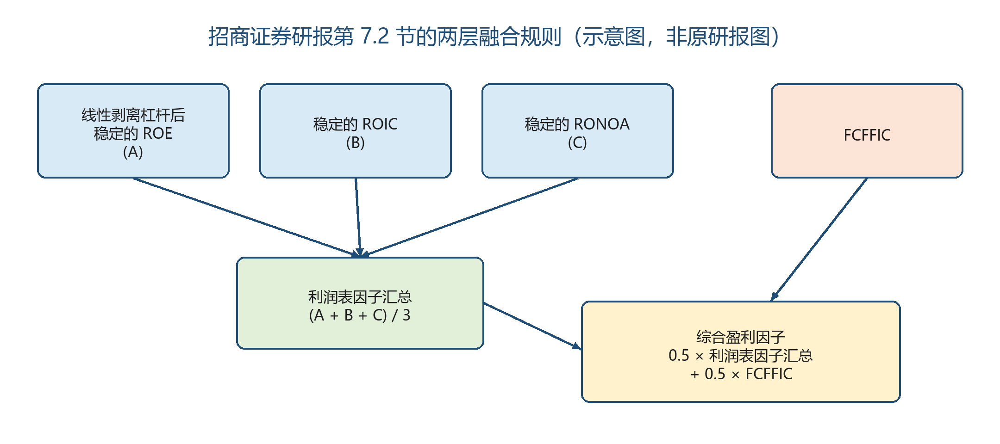
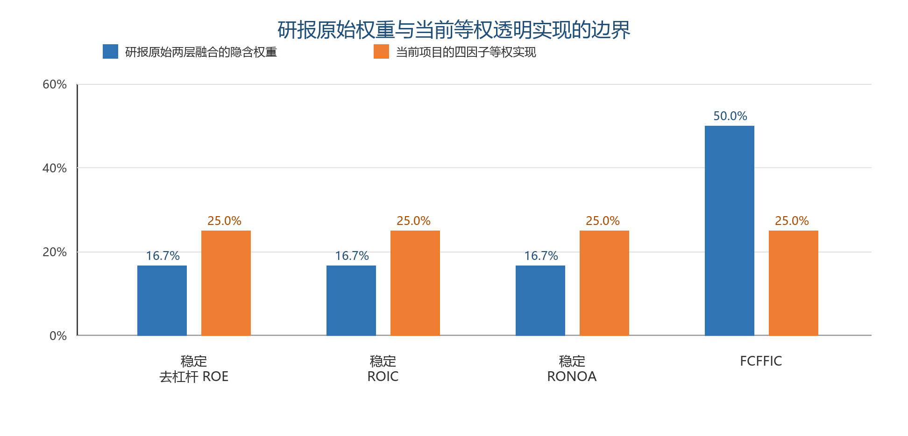
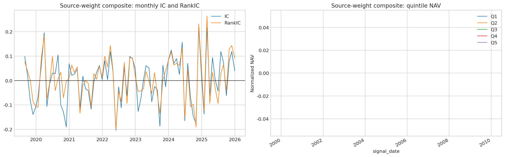
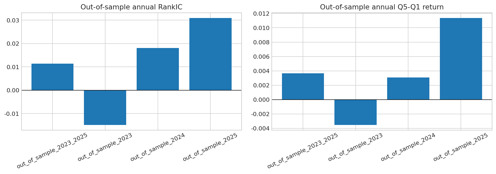
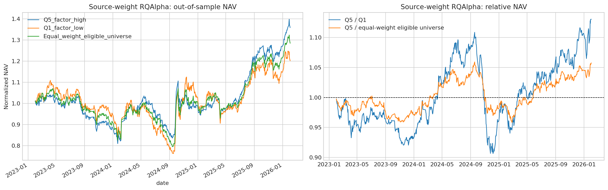
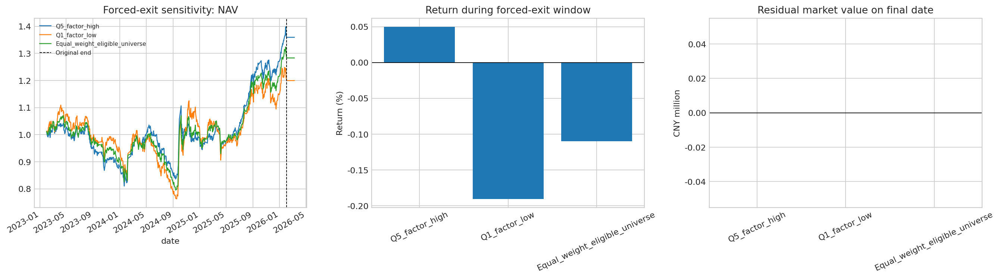

# 综合盈利因子研报原始权重版本研究报告

> 研究状态：`candidate_not_confirmed`

## 执行摘要

本报告记录综合盈利因子的研报原始权重版本复现。研究沿用项目已经冻结的四个底层子因子、数据时点、动态中证 800 股票池、样本划分、收益标签、横截面处理与 RQAlpha 执行规则，只将最终合成权重替换为招商证券研报第 7.2 节的两层融合规则。

结果显示，该权重版本的样本外回测表现强于历史等权合成对照版本：强制清仓后，Q5 相对 Q1 的逐日净值比值收益为 13.577%，相对等权可投资股票池为 6.196%，且三组均完成清仓。但完整样本外的 RankIC HAC p 值为 0.4796，Q5-Q1 HAC p 值为 0.4300，均未达到预设的 5% 显著性门槛。

因此，本报告将该信号保留为**研究候选**，不表述为已确认的独立 Alpha。此次权重版本在此前 2023—2025 样本外结果已经被观察后开展，结果只能视为权重敏感性与扩展复现证据，不能视为新的首次确认性样本外验证。

## 1 研究问题与边界

研究问题是：企业盈利能力信息能否在 A 股动态中证 800 股票池中，对未来 20 个交易日收益形成稳定排序，并在考虑实际交易约束后带来超过不按因子排序的等权可投资股票池的增量收益？

Alpha 假设为：持续的经营回报、较低的盈利波动、较少的杠杆放大以及较高的自由现金流质量，可能反映企业竞争优势、资本配置能力或市场对基本面持续性的定价滞后。该假设需要由横截面统计检验和可执行组合回测共同支持，不能由绝对收益单独确认。

本项目使用 RiceQuant 点时数据和既有透明代理口径。它不声称完整复现研报所依赖的全部 Wind 原始字段；结论只对应本项目的重构输入与执行设定。

## 2 综合盈利因子的研报逻辑

招商证券《基本面量化系列研究之四：企业盈利能力评价指标的演进与优化》将盈利能力从单一 ROE 拓展为多维度评价：

1. **线性剥离杠杆后稳定的 ROE**：降低权益乘数对 ROE 的机械放大，强调盈利持续性；
2. **稳定的 ROIC**：观察投入资本形成税后经营回报的效率与稳定性；
3. **稳定的 RONOA**：从净经营资产角度衡量经营资产回报的稳定性；
4. **FCFFIC**：用自由现金流相关指标补充利润的现金质量。

研报第 7.2 节先将前三项形成“利润表因子汇总”，再与 FCFFIC 融合：

$$
\text{利润表因子汇总}=(A+B+C)/3
$$

$$
\text{综合盈利因子}=0.5\times\text{利润表因子汇总}+0.5\times FCFFIC
$$

其中 A、B、C 分别对应前三项。因此，四个底层子因子的隐含权重为 **1/6、1/6、1/6、1/2**。这意味着 FCFFIC 在最终综合盈利因子中占 50%，而每个利润表因子各占约 16.67%。

图 1：研报第 7.2 节两层融合规则的原创示意图，非原研报图表。

## 3 本项目的因子构造

本项目以研报术语为名称，但保留以下透明代理或重构口径：

| 底层子因子 | 项目计算口径 | 经济含义 |
| --- | --- | --- |
| 线性剥离杠杆后稳定的 ROE | 先对 ROE 与权益乘数做横截面线性剥离；再将去杠杆 ROE 与过去 9 个 TTM ROE 的负波动率等权组合 | 弱化财务杠杆放大，偏好可持续且波动较低的股东回报 |
| 稳定的 ROIC | `ROIC = NOPLAT / IC`；将当期 TTM ROIC 与过去 9 个季度间隔 TTM ROIC 的负波动率组合 | 衡量投入资本创造持续税后经营利润的能力 |
| 稳定的 RONOA | 使用核心经营利润相对投入资本的透明代理，并与历史负波动率组合 | 以经营资产视角刻画稳定经营回报；该项为项目代理 |
| FCFFIC | `(CFO_TTM - capex_TTM) / IC`；金融、非银金融、综合金融和房地产不参加该口径测试 | 用自由现金流补充会计利润，关注现金盈利质量 |

构造顺序如下：

1. 四个子因子在同一信号日必须同时可用，不做个股层面缺失填补；
2. 按研报两层规则计算原始合成得分；程序逐元素核对两层公式与 `1/6、1/6、1/6、1/2` 展开公式一致；
3. 为保持与历史对照可比，对合成得分沿用一次 MAD 去极值、中信 2019 一级行业与对数市值中性化，最后 z-score 标准化；
4. 不在历史流程之外增加第二次中性化、重新选股或重新设定持有期。

图 2：研报原始权重版本与历史等权合成对照版本的权重对比。

## 4 数据、时间对齐与验证设计

| 项目 | 规则 |
| --- | --- |
| 股票池 | 动态中证 800 成分股 |
| 证券筛选 | 上市满 252 个交易日；信号日排除 ST 与停牌股票 |
| 数据口径 | RiceQuant 点时财务字段；TTM/MRQ 口径 |
| 有效样本 | 四个子因子、股票池掩码、行业分类和市值字段共同可用的 2019—2025 月度样本，共 77 期 |
| 样本内 / 样本外 | 有效样本中的 2019—2022（41 期）/ 2023—2025（36 期） |
| 预测目标 | 信号日后首个交易日开盘至 T+21 开盘的 20 个交易日收益排序 |
| 因子检验 | IC、RankIC、五分组收益、Q5-Q1；重叠标签使用 Newey-West/HAC 标准误 |
| 组合 | Q5 高分组、Q1 低分组、等权可投资股票池；均按活跃持仓批次分配资金 |

严格样本外只有 36 个观测期，因此单个年度的亮眼结果不能替代完整样本外的 HAC 结论。

## 5 样本外因子证据

| 指标 | 2023—2025 样本外结果 | 解释 |
| --- | ---: | --- |
| 平均 IC | 0.00962 | 方向为正 |
| 平均 RankIC | 0.01136 | 横截面排序方向为正 |
| RankIC HAC p 值 | 0.4796 | 未达到 5% 显著性门槛 |
| Q1 月均收益 | 0.7189% | 低分组平均收益 |
| Q5 月均收益 | 1.0831% | 高分组平均收益 |
| Q5-Q1 月均收益 | 0.3642% | 高低分组差为正 |
| Q5-Q1 HAC p 值 | 0.4300 | 未达到 5% 显著性门槛 |

图 3：有效样本、样本内与样本外的 IC、RankIC 与五分组表现。

年度结果存在市场状态差异：2023 年 RankIC 和 Q5-Q1 为负；2024 年转正但不显著；2025 年 Q5-Q1 的单年 HAC p 值为 0.0181。后者是有价值的诊断线索，但不能替代完整 36 期样本外检验，也不应据此回看调参。

图 4：样本外各自然年的 RankIC 与 Q5-Q1 均值。

## 6 RQAlpha 执行约束回测

回测使用 1 亿元初始资金与中证 800（`000906.XSHG`）基准。执行设定包括开盘撮合、佣金乘数 0.375、最低佣金 5 元、卖出印花税、涨跌停限制、整手下单和单日 5% 成交量上限。Q5 与 Q1 分别选择可投资股票中的最高或最低 20%，等权可投资股票池不使用因子排序，用来衡量因子选择相对于广泛可投资机会集的边际价值。

| 组合 | RQAlpha 累计收益 | 年化收益 | 信息比率 | 最大回撤 | 相对 CSI 800 的逐日净值比值收益 |
| --- | ---: | ---: | ---: | ---: | ---: |
| Q5 高分组 | 35.902% | 11.139% | 0.905 | 22.200% | 18.099% |
| Q1 低分组 | 20.226% | 6.547% | 0.126 | 31.227% | 4.232% |
| 等权可投资股票池 | 28.489% | 9.013% | 0.689 | 25.685% | 11.386% |

“RQAlpha 累计收益”来自回测汇总字段；“相对 CSI 800 收益”直接由对齐后的逐日单位净值比值计算。两者起点口径不同，报告不将二者混为同一指标。

图 5：Q5、Q1 与等权可投资股票池的 RQAlpha 样本外净值及相对净值。

## 7 强制清仓与增量选股检验

原始回测目标权重结束于 2026-02-02。当日部分证券处于跌停，无法立即卖出。为检验末日市值计价是否影响结论，项目在原始目标日之后追加了 20 个真实交易日，每日目标权重设为零，并保持相同的涨跌停与成交约束。

| 组合 | 清仓窗口后尾部收益 | 最终股票市值 | 追加期间成交笔数 | 清仓完成 |
| --- | ---: | ---: | ---: | --- |
| Q5 高分组 | 0.0500% | 0 | 4 | 是 |
| Q1 低分组 | -0.1904% | 0 | 2 | 是 |
| 等权可投资股票池 | -0.1098% | 0 | 10 | 是 |

| 比较 | 原始结束日相对收益 | 强制清仓后相对收益 | 清仓尾部变化 |
| --- | ---: | ---: | ---: |
| Q5 相对 Q1 | 13.304% | 13.577% | 0.273% |
| Q5 相对等权可投资股票池 | 6.026% | 6.196% | 0.170% |

图 6：追加零权重退出窗口后的净值、尾部收益与期末残余市值。

清仓后 Q5 仍超过 Q1 和等权可投资股票池，且三个组合最终市值均为零。因此，回测排序与增量收益结论不依赖 2026-02-02 的未成交头寸按市值计价。

## 8 与历史等权合成对照的比较

| 指标 | 研报原始权重版本 | 历史等权合成对照版本 |
| --- | ---: | ---: |
| 样本外平均 RankIC | 0.01136 | 0.00369 |
| RankIC HAC p 值 | 0.4796 | 0.8178 |
| 样本外 Q5-Q1 月均收益 | 0.3642% | 0.1092% |
| Q5-Q1 HAC p 值 | 0.4300 | 0.8317 |
| 强制清仓后 Q5 相对 Q1 | 13.577% | 4.112% |
| 强制清仓后 Q5 相对等权可投资股票池 | 6.196% | -0.036% |

在当前样本与执行设定下，研报原始权重版本的方向性与回测表现均优于等权合成对照版本。最直接的结构变化是 FCFFIC 权重从 25% 提升至 50%，前三项利润表因子的单项权重降至约 16.67%。

但该比较是**权重敏感性对照**。两种权重版本都在已经观察过的样本外区间中比较，不能把表现改善表述为新的、独立的确认性发现。

## 9 研究判断

本实验的三类证据并不完全一致：

1. 横截面统计证据方向为正，但完整样本外 HAC 显著性不足；
2. Q5 相对 Q1 的排序证据较强；
3. Q5 在强制清仓后也超过等权可投资股票池，显示出正向的增量选股回测证据。

预先写定的研究门槛要求前两类统计证据和第三类执行证据同时满足，才讨论独立 Alpha。由于前两项 HAC 检验未通过，本次最终状态仍为 `candidate_not_confirmed`。

这不是“因子无效”的结论，也不是“因子已确认”的结论。更准确的说法是：研报原始权重版本值得保留为后续研究候选；下一次检验应使用此前未被观察的新样本，事先冻结权重、口径和决策规则。

## 10 下一步研究设计

1. 新增未观察的样本期，并在运行前冻结研报权重、子因子代理口径和执行规则；
2. 对因子暴露做行业、规模、价值、质量等风险归因，识别收益来自何种共同风险；
3. 加入滑点、冲击成本与容量压力测试，评估资金规模扩大后的收益折损；
4. 保留等权合成对照作为权重敏感性实验，不再使用已观察到的 2023—2025 样本外收益调整权重或阈值。

## 11 复现与公开边界

- 核心规则：[研报原始权重扩展复现协议](11_SOURCE_WEIGHT_REPLICATION_PROTOCOL.md)；
- 因子检验：[11_source_weight_factor_effectiveness_summary.csv](../artifacts/tables/11_source_weight_factor_effectiveness_summary.csv) 与 [11_source_weight_hac_stability_summary.csv](../artifacts/tables/11_source_weight_hac_stability_summary.csv)；
- 执行回测：[11_source_weight_oos_three_portfolio_performance.csv](../artifacts/tables/11_source_weight_oos_three_portfolio_performance.csv)；
- 强制清仓：[11_source_weight_forced_exit_sensitivity_performance.csv](../artifacts/tables/11_source_weight_forced_exit_sensitivity_performance.csv) 与 [11_source_weight_forced_exit_relative_comparison.csv](../artifacts/tables/11_source_weight_forced_exit_relative_comparison.csv)。

公开仓库只包含代码、聚合表、图表、规则文件和无输出 Notebook。原始数据、缓存、个股目标权重、成交明细、原始回测对象与凭证均不公开。

方法来源：招商证券，《基本面量化系列研究之四：企业盈利能力评价指标的演进与优化》，2025-11-21，第 7.2 节。原研报受版权保护，仅作为方法来源引用，不随仓库发布。
